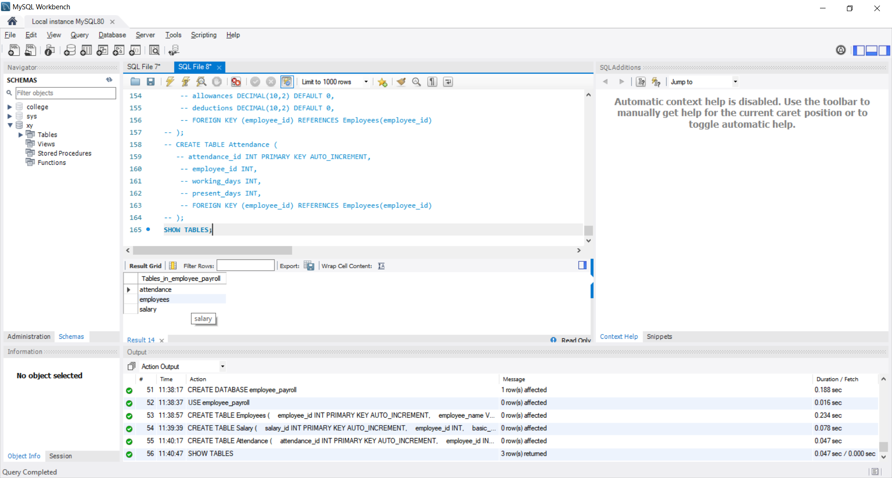
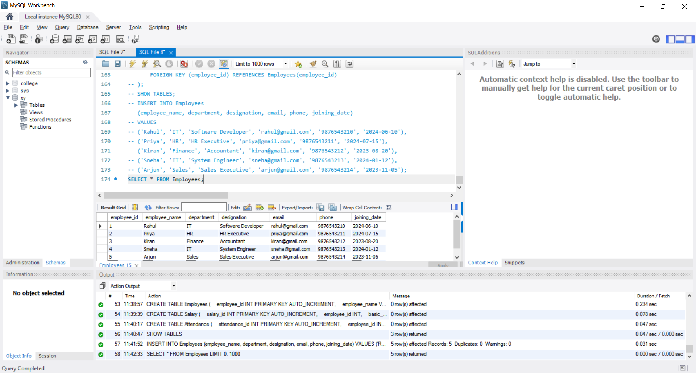
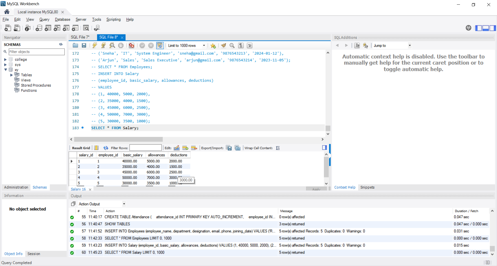
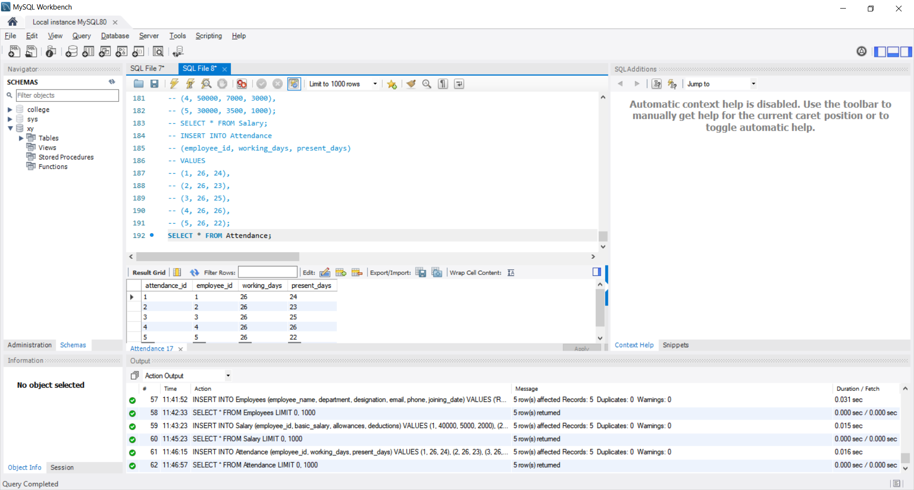
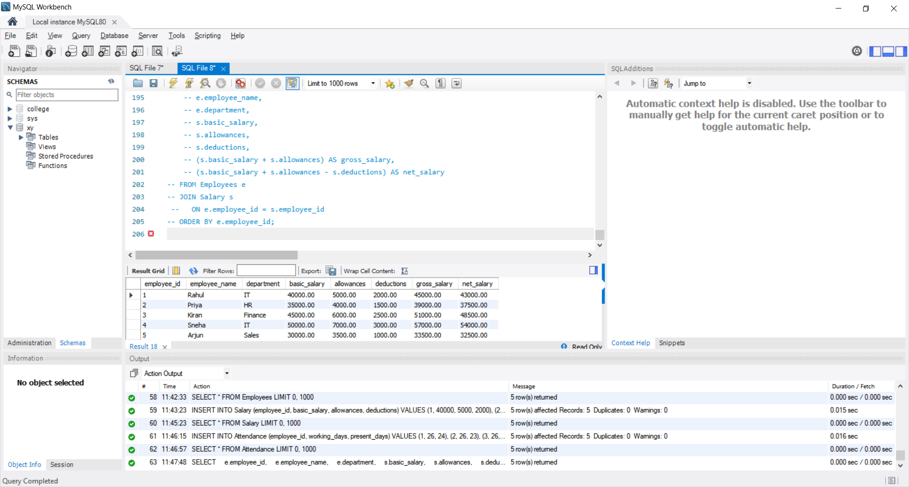
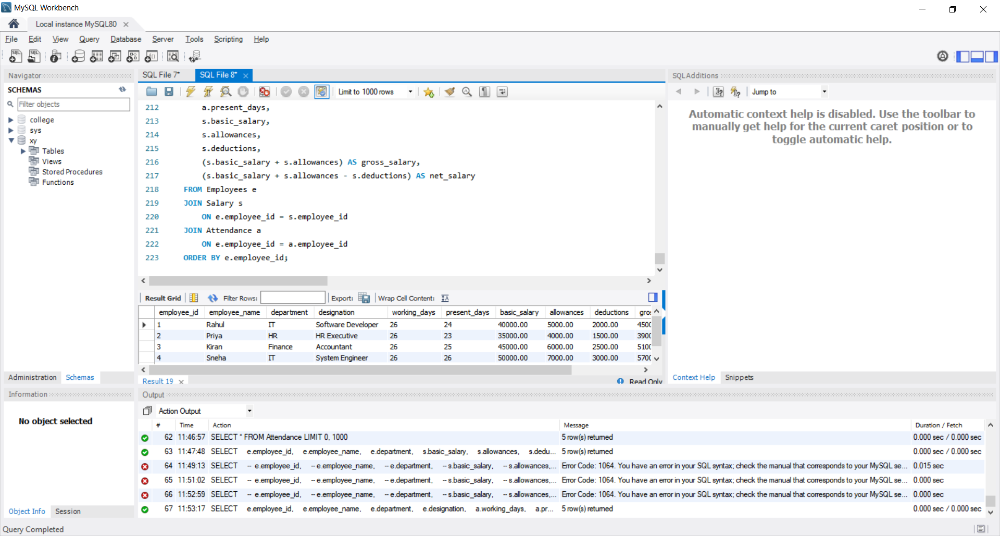

# CODTECH Internship Task-3

## Employee Payroll Database

**Company:** CODTECH IT SOLUTIONS

**Intern Name:** GOGULAPATI LAKSHMI POORNIMA

**Intern ID:** CTIS9030

**Domain:** SQL

**Duration:** 12 Weeks

**Mentor Name:** Neela Santosh Kumar

## Objective

The objective of this project is to develop an Employee Payroll Database using MySQL.

The project focuses on:

* Managing employee information
* Managing salary details
* Managing employee attendance
* Calculating gross salary
* Calculating net salary
* Generating a complete payroll report
* Identifying the highest-paid employee

## Description

This project implements an Employee Payroll Database using MySQL. The system contains three tables: Employees, Salary, and Attendance.

SQL queries are used to store employee information, salary details, attendance records, and generate payroll calculations including gross salary and net salary.

## Database Tables

### Employees

Stores employee information including Employee ID, Name, Department, Designation, Email, Phone, and Joining Date.

### Salary

Stores employee salary information including Basic Salary, Allowances, and Deductions.

### Attendance

Stores employee working days and present days.

## Salary Calculation

**Gross Salary = Basic Salary + Allowances**

**Net Salary = Basic Salary + Allowances − Deductions**

## Features

* Employee data management
* Salary data management
* Attendance management
* Gross salary calculation
* Net salary calculation
* Complete payroll report
* Highest-paid employee identification
* Department-wise payroll analysis

## Tools Used

* MySQL
* MySQL Workbench
* SQL

## Files in Repository

* `Task_3_Employee_Payroll_Database.sql`
* `README.md`
* `Screenshots/SS_1_Database_Tables.png`
* `Screenshots/SS_2_Employees_Data.png`
* `Screenshots/SS_3_Salary_Data.png`
* `Screenshots/SS_4_Attendance_Data.png`
* `Screenshots/SS_5_Salary_Calculation.png`
* `Screenshots/SS_6_Final_Payroll_Report.png`

# Proof of Execution

## SS 1 — Database and Tables

## SS 2 — Employees Data

## SS 3 — Salary Data

## SS 4 — Attendance Data

## SS 5 — Salary Calculation

## SS 6 — Final Payroll Report

## Conclusion

The Employee Payroll Database was successfully implemented using MySQL.

The project successfully manages employee details, salary information, attendance records, and payroll calculations. The system calculates gross salary, net salary, and generates a complete employee payroll report using SQL queries.
